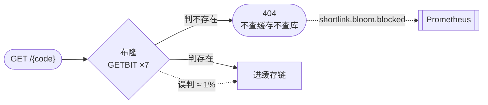
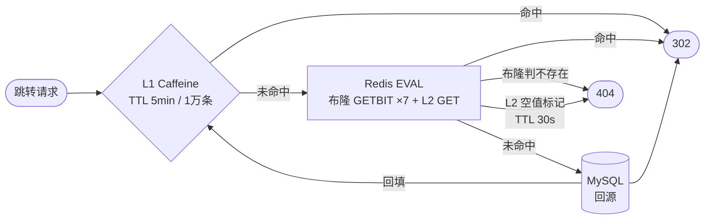
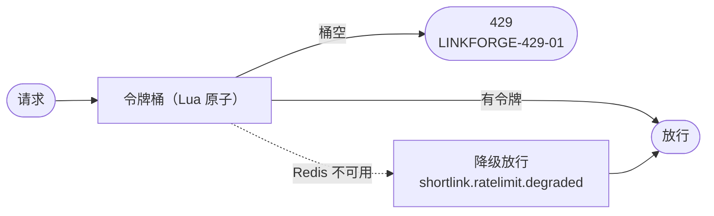
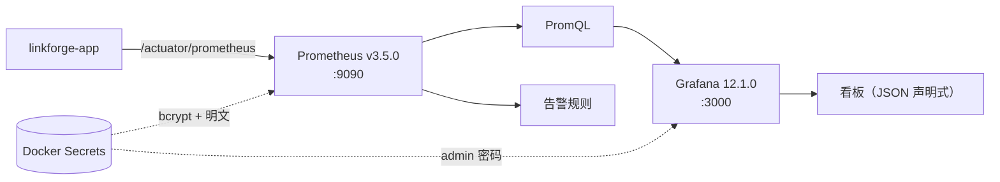
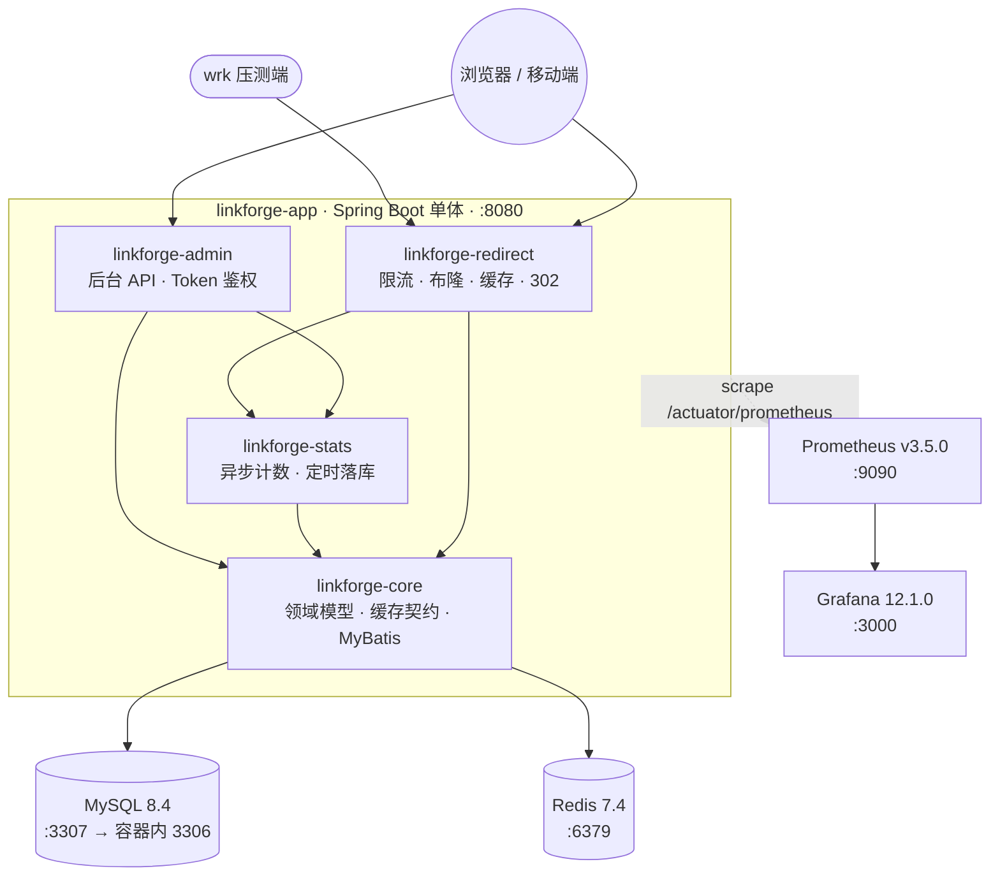
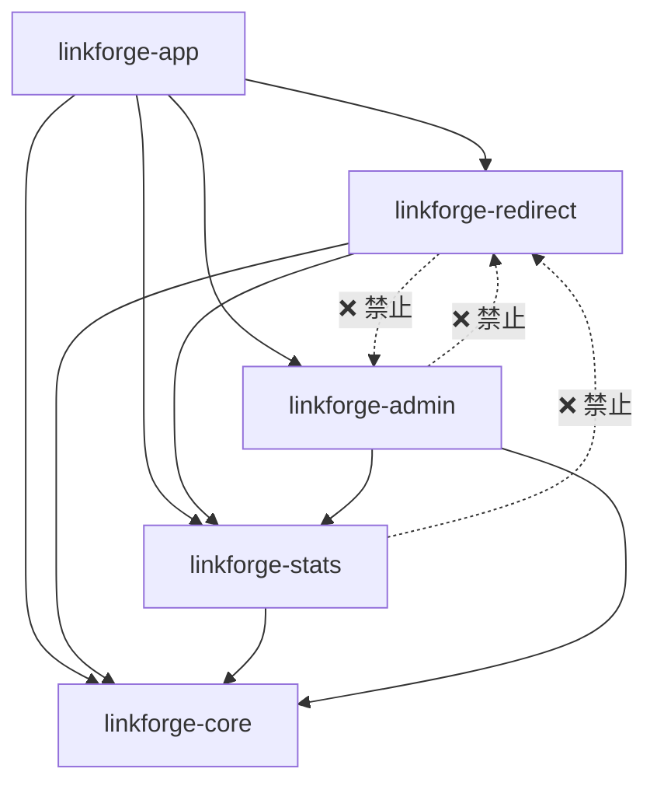

# LinkForge

> 分布式短链平台 —— Java 后端求职项目。
> 目标：把「长链 → 短码 → 302 跳转」这条读多写少链路做到**可量化**的高性能，
> 并且**每个优化都有前后对比数据**，每个「据说」都有一次实测。

| | |
|---|---|
| **技术栈** | Java 17 · Spring Boot 3 · MyBatis · MySQL 8.4 · Redis 7.4 · Caffeine · Docker Compose · Prometheus · Grafana |
| **工程约束** | Maven 5 模块 + ArchUnit 强制依赖边界 · JUnit 5 + Testcontainers 真实 MySQL 集成测试 · **64 条决策记录** · **26 条排障条目** |
| **实测结论** | 跳转 **29,388 QPS / P99 11.00ms**（同口径 3×30s 中位）· 8 小时长稳 **0 次 Full GC** · 后端拐点 **c=400~800** |

---

## 当前进度

**第 6 周：项目收尾与复盘 —— 已完成。**

| 项 | 状态 |
|---|---|
| JDK | OpenJDK **17.0.0.1** |
| 构建 | Maven Wrapper（**Maven 3.9.12**），本地仓库在项目内 `.mvn-repo` |
| MySQL | `mysql:8.4`（容器内 3306，**宿主机映射 3307**） |
| Redis | `redis:7.4`（宿主机 6379，已启用 RDB） |
| 监控 | Prometheus `v3.5.0` + Grafana `12.1.0`（全声明式 provisioning） |
| 部署 | Docker Compose **一键起全套 5 个容器** |
| 测试 | **611 全绿 / 0 失败 / 0 跳过**（含 **68** 个真实 MySQL 容器测试 + **20** 个真实 Redis 集成测试 + 3 个 ArchUnit 架构约束测试） |

**前置需求**：Docker Desktop 已启动；`JAVA_HOME` 指向 **JDK 17**。

---

## 核心特性

### 1. 布隆过滤器：把「不存在的短码」挡在缓存与数据库之前

短链读多写少，绝大多数请求是**不存在的短码**（爬虫、扫号、typo）。
布隆过滤器用 11.4 MB 位数组把这类请求挡在网络往返与数据库之外。



| 项 | 值 | 出处 |
|---|---|---|
| 容量 `n` | **10,000,000** | 编译期常量（DR-007） |
| 位数组 | **95,850,584 bit ≈ 11.43 MB** | `BloomHash.BIT_SIZE` |
| Hash 函数 | **7 个**（双 seed 的 MurmurHash 变体） | `BloomHash.HASH_COUNT`（理论最优 k=6.644，向上取 7） |
| 理论误判率（满容量 n=1000万） | **≈ 1.004%**（目标 p=0.01） | `(1-e^(-kn/m))^k` |
| 位分布实测 | `scripts/bloom-fprate.py`（n=1000 时观测 0.0000%） | **用途是确认位分布无退化，不是确认 k** |
| 存储 | Redis `shortlink:bloom`（**全局唯一权威**） | — |
| 重建 | 写 `:building` 临时 key → 扫全库 → `RENAME` 原子替换 | `BloomFilterMaintenance` |

⚠️ **规格写死，不在运行时计算**：`n` 与误判率一旦随数据量漂移，
「为什么误判率变了」就变成一个无法回答的问题。

### 2. 两级缓存：L1 进程内 + L2 全局共享



| 层 | 实现 | 内容 | TTL | 关键设计 |
|---|---|---|---|---|
| L1 | Caffeine（进程内） | **只缓存正结果** | **5 分钟** / 1 万条 | 空值**不下沉** L1（DR-047）——否则短码被创建前的 404 会被粘住 5 分钟 |
| L2 | Redis | 正结果 + 空值标记 | **1 小时 + 0~5 分钟随机抖动** | 抖动是**防雪崩**的核心：同批写入的 key 不会集体失效 |
| 空值 | Redis | 空标记 | **30 秒** | 防穿透第二道防线，TTL 必须短 |

⭐ **DR-051/DR-052：把布隆与 L2 查询合并成一次 Redis 往返**。
最初的实现是「布隆 → L2」两次独立调用，QPS 只有 **3,153**；
合并成一次 EVAL 后回到 **81,290**（25.8x）。这是本项目最关键的一次优化。

### 3. 限流：Redis + Lua 令牌桶，四套独立阈值



| scope | 默认阈值 | Key |
|---|---|---|
| `redirect` | **20 / 秒** | `shortlink:limit:{clientId}:redirect` |
| `create` | **10 / 分钟** | `shortlink:limit:{clientId}:create` |
| `query` | **60 / 秒** | `shortlink:limit:{clientId}:query` |
| `admin` | **30 / 分钟** | `shortlink:limit:{clientId}:admin` |

- 实现是**自研 Redis + Lua**（令牌桶 + `PEXPIRE` 原子续期，DR-056），未引入 Redisson。
- 限流**不引入开关**：v1 的降级策略是**直接放行**（DR-010）；
  另有一个 `linkforge.ratelimit.enabled` 开关专供压测 A/B 对照使用。

⚠️ **限流是第 3 周的真凶**：第 2 周 QPS 8.1 万 → 第 3 周 2.76 万，
**降 66% 全部由限流造成**（A/B 对照实测），不是缓存退化，也不是布隆误判。

### 4. 可观测性：Micrometer 指标 + Prometheus + Grafana 全声明式



| 主题 | 指标 |
|---|---|
| 缓存 | `shortlink.cache.local.hit` · `shortlink.cache.redis.hit` · `shortlink.cache.miss` · `shortlink.cache.evict.failed` |
| 布隆 | `shortlink.bloom.blocked` · `shortlink.bloom.put.failed` · `shortlink.bloom.rebuild` |
| 限流 | `shortlink.ratelimit.rejected` · `shortlink.ratelimit.degraded` · `shortlink.ratelimit.bypassed` |
| 统计 | `shortlink.stats.offered` / `dropped` / `flushed` / `queue.size` / `flush.duration` / `dlq.*` |
| 过期清理 | `shortlink.cleanup.scanned` / `cleared` / `cache.evicted` / `duration` / `failed` |
| 元数据 | `shortlink.meter.count`（**Meters 总数**，长稳测试的关键对照曲线） |

⭐ **凭据全部走 Docker Secrets**：`docker inspect` 看不到明文。
Prometheus 的 bcrypt 哈希进 git，明文走 secret 挂载，两处必须配套 —— 这是 DR-055 的主题。

⚠️ **绝对不能开 `http.server.requests` 的 `path` tag**：
每个短码都是一个新 label value，**cardinality 无限增长**，
会撑爆堆内存（`shortlink.meter.count` 就是用来盯这件事的）。

---

## 架构

### 整体拓扑



### 模块依赖（编译期 + ArchUnit 双重强制）



- `linkforge-core` —— 领域模型、错误码、缓存/布隆契约、**MyBatis 数据访问实现**（DR-021）。
- `linkforge-redirect` —— 跳转链路，**不得依赖 admin**（PRD D-4 物理隔离）。
- `linkforge-stats` —— 统计计数与落库。
- `linkforge-admin` —— 后台查询与删除。
- `linkforge-app` —— 装配与启动，**唯一产出可执行 jar**。

> 依赖规则不靠「自觉」：Maven 模块在**编译期**就拦得住，
> `ModuleBoundaryArchTest`（ArchUnit）在**构建期**再拦一次。

### 跳转链路的成本分层

| 步 | 动作 | 预算 | 命中即终止 |
|---|---|---|---|
| 1 | 按 IP 限流（Redis + Lua） | ≤ 1ms | 超限 → 429 |
| 2 | **L1 Caffeine 正结果缓存** | ≤ 0.1ms | 命中 → 302 |
| 3 | **布隆 + L2 合并为一次 Redis 往返** | ≤ 3ms | 布隆判不存在 → 404 |
| 4 | 回源 MySQL 并回填缓存 | ≤ 200ms 超时 | 是 |
| 5 | 异步计数（PV/UV）非阻塞投递 | 不等待 | — |
| 6 | 返回 302 | ≤ 1ms | — |

---

## 性能演进史

### 同口径对比（第 1 / 2 / 3 周 与 第 5 周组 A）

> **同口径定义**：容器内 `wrk -t4 -c100 -d30s` + 同一份 **1 万条真实短码**语料 +
> **3 轮取中位数**（不是取最好的一轮）。完整口径声明见
> [docs/PERFORMANCE.md §3](docs/PERFORMANCE.md)。

| 指标 | 第 1 周<br/>无缓存 | 第 2 周<br/>两级缓存 | 第 3 周<br/>+ 限流/布隆 | 第 5 周 组 A<br/>**最终** | 第 1→5 周 |
|---|---|---|---|---|---|
| **QPS** | 13,426 | 81,289 | 27,641 | **29,387.67** | **+118.9%** |
| P50 | 6.59ms | 0.97ms | 3.30ms | **3.08ms** | **−53.3%** |
| P90 | 18.33ms | 1.95ms | 5.67ms | **5.36ms** | −70.8% |
| P99 | 36.32ms | 4.58ms | 11.74ms | **11.00ms** | **−69.7%** |
| L1 命中率 | — | — | 90.9% | 未采 | — |
| 非 302 响应 | 0 | 0 | 0 | **0** ✅ | 持平 |
| Socket timeout | 15 | 48 | 8 | **4** | −73.3% |
| 压测窗口 ERROR | 0 | 0 | 0 | **0** ✅ | 持平 |

**怎么读这张表**（三条坑都在这表里）：

1. ⚠️ **第 2 周的 QPS 高不代表「优化成功」**。
   那一周的命中率是 **100%** —— 因为预热 10s 刚好把 1 万条全灌进
   `maximumSize=10000` 的 Caffeine，窗口内无新增、无淘汰。
   这是**实验设计的必然结果**，不是生产命中率。
2. ⚠️ **第 3 周的 QPS 比第 2 周低 66%，但不是退化**。
   A/B 对照证明这 66% **全部由限流造成**（20/s 的令牌桶），
   与缓存、布隆都无关。
3. ⚠️ **第 5 周组 A 与前三周绝对值可比，但宿主环境更脏**：
   宿主固有占用 ≈ **3.0 核**（Agent 进程 ≈ 2.0 核），第 1~3 周不存在此偏差。
   理论本机上限 ≈ 32,400 QPS，组 A 已达 **90.7%**。

### 后端容量拐点（第 5 周组 C：固定 `-t4`，递增 `-c`）

| 连接数 `-c` | QPS | P50 | P99 | Socket timeout | wrk CPU 峰值 |
|---|---|---|---|---|---|
| 50 | 18,247.29 | 2.31ms | 11.31ms | 0 | 138.40% |
| 100 | 20,979.69 | 4.20ms | 19.22ms | 10 | 152.59% |
| 200 | 25,223.01 | 7.15ms | 24.14ms | 0 | 156.49% |
| **400** | **28,757.87** | 12.86ms | 34.77ms | 0 | 177.29% |
| **800** | **26,435.40** ↓ | 27.80ms | **76.06ms** | 0 | 177.58% |

⭐ **拐点在 `c=400 ~ c=800` 之间**：QPS 涨不动且 P99 恶化 119%。
wrk 的 CPU 峰值只有 138~178%（**压测端远未饱和**），所以这条曲线反映的是**后端**的真实容量。

> ⚠️ **先前的阶梯设计答错了题**：固定 `-c50` 递增 `-t` 测的是**压测端的饱和点**（峰值 21,660），
> 不是后端容量 —— 因为 wrk 的 `-c` 是**总连接数**，后端看到的并发深度根本没变。
> 问「后端在多大并发下开始降级」必须递增 `-c`。这个认知修正记录在
> [docs/PERFORMANCE.md §11.6](docs/PERFORMANCE.md)。
>
> ⚠️ **本组绝对值受宿主负载污染**（第二轮同时在做文档编辑与 `docker stats`），
> **只用于判读曲线形状**，不与组 A 直接比较。

### 8 小时长稳（第 5 周阶段 3）

| 项 | 基线（15:09） | 8 小时后（23:09） | 结论 |
|---|---|---|---|
| Metaspace | 72.47 MB | **74.02 MB** | 增量 **+1.55MB** 且**已完全走平** |
| 已加载类数 | 14,946 | 14,996 | 增量收敛（类加载，不是泄漏） |
| `shortlink.meter.count` | 197 | 199 | 后 6 小时**恒定** |
| Young GC | — | **14,388 次** | — |
| **Full GC** | — | **0 次** | ✅ |
| 累计 PV | — | **369,536,164** | 平均 ≈ **12,566 QPS** |

⭐ **本项目最反直觉的一条结论**：
> **Metaspace 是类加载，Micrometer 动态 Tag 增长的是堆。**
> 「Micrometer 动态 Tag 导致 Metaspace 泄漏」的因果链**不成立** ——
> Micrometer 每次 `registry.counter(...).increment()` 只创建新的 `Meter` 对象（堆），
> **不会创建新类**。实测 8 小时 Metaspace 只涨 1.55MB 且收敛，
> 而 `shortlink.meter.count` 从 197 涨到 199 后**恒定**。
> 详见 [DR-061](docs/DECISIONS.md) 与 [docs/PITFALLS.md](docs/PITFALLS.md)。

---

## 快速开始

### 方式一：Docker Compose 一键起全套（推荐，含监控栈）

```bash
# 1. 初始化本地环境（生成 .env + Docker Secrets，并校验凭据一致性）
bash scripts/setup-local.sh

# 2. 启动全套 5 个容器
docker compose up -d
docker compose ps          # 期望 5 个服务均 healthy

# 3. 验证监控链路
curl -u "linkforge:$(cat docker/secrets/prometheus_basic_auth.txt)" \
     http://localhost:9090/api/v1/targets
```

> ⚠️ `setup-local.sh` 是**幂等**的：已存在的 `.env` 与 secret **一律跳过、不覆盖**；
> 若已存在但内容不可用（空文件、缺关键变量），脚本会**明确报错并停止**，
> 而不是静默重建把你改过的配置冲掉。
> 确实要推倒重来时用 `bash scripts/setup-local.sh --force`（会先备份成 `*.bak`）。

| 服务 | 地址 | 凭据 |
|---|---|---|
| 应用 | http://localhost:8080 | 无（公开接口） |
| Prometheus | http://localhost:9090 | 用户名 `linkforge`，密码见 `docker/secrets/prometheus_basic_auth.txt` |
| Grafana | http://localhost:3000 | 用户名 `admin`，密码见 `docker/secrets/grafana_admin_password.txt` |
| MySQL | localhost:3307 | 见 `.env` |
| Redis | localhost:6379 | 无密码（**已知风险**，仅限本地开发） |

### 方式二：本地跑应用（开发调试用）

```bash
# 1. 准备环境变量（.env 只放本地占位值，已被 .gitignore 忽略）
cp .env.example .env          # Windows: Copy-Item .env.example .env

# 2. 启动 MySQL 与 Redis
docker compose up -d mysql redis

# 3. 验证 Redis
docker compose exec redis redis-cli ping

# 4. 验证构建工具
./mvnw -v

# 5. 启动应用（从 .env 注入环境变量后运行）
./scripts/run-local.sh
```

### 改监控凭据

```bash
# 生成 bcrypt 哈希，并同步「哈希（进 git）」与「明文（gitignore）」两处
bash scripts/gen-prometheus-hash.sh '你的新密码'

# ⚠️ 密码改完必须重建 Prometheus **并重置 Grafana 数据源**
docker compose up -d --force-recreate prometheus
bash scripts/reset-grafana-datasource.sh
```

> ⚠️ **为什么必须三步都做**：Grafana 的 datasource provisioning
> **不会覆盖已存在数据源的 `secureJsonData`**（Grafana 刻意如此设计）。
> 于是 Prometheus 用了新密码，而 Grafana 里存的还是**旧密码的密文** →
> 数据源健康检查 401、所有面板 No data，**而 provisioning 日志一切正常**。

### 运行 Redis 演示

```bash
# 在项目根目录执行（Windows 上加 -Dstdout.encoding=UTF-8 以免中文输出乱码）
./mvnw -pl linkforge-core exec:java -Dexec.mainClass=com.linkforge.core.demo.RedisDemo

# 指定 host / port
# -Dredis.host=127.0.0.1 -Dredis.port=6379

# 保留演示 key，便于手动观察
# -Dredis.keepKeys=true
```

---

## 项目结构

Maven 多模块（**5 个模块**），依赖规则见 [docs/DECISIONS.md](docs/DECISIONS.md) DR-018 / DR-021：

```
linkforge-parent           父 POM：版本管理、编译配置
├── linkforge-core         领域模型、错误码、缓存/布隆契约、MyBatis 数据访问实现
├── linkforge-redirect     跳转链路：控制器、缓存查找、布隆、限流
├── linkforge-stats        统计：计数、按天聚合、定时落库
├── linkforge-admin        后台：删除短链、过期清理、Token 鉴权
└── linkforge-app          启动 + 装配（唯一产出可执行 jar）
```

依赖方向：

```
app      → core + redirect + stats + admin
redirect → core + stats          admin → core + stats
stats    → core
redirect → admin   ❌ 禁止        admin → redirect ❌ 禁止
```

隔离由编译器强制，并由 `linkforge-app` 中的 `ModuleBoundaryArchTest`（ArchUnit）在构建时二次校验。

构建：

```powershell
.\mvnw.cmd clean install        # 首次会下载依赖树，耗时较长属正常
.\mvnw.cmd clean verify         # 含架构约束测试
```

---

## 文档

设计与决策文档在 [`docs/`](docs/)：

| 文档 | 内容 |
|---|---|
| [PROJECT_BRIEF.md](docs/PROJECT_BRIEF.md) | 项目目标与约束（唯一来源） |
| [PRD.md](docs/PRD.md) | v1 范围、用户故事、验收标准 |
| [ROADMAP.md](docs/ROADMAP.md) | 6 周排期、里程碑、环境快照 |
| [ARCHITECTURE.md](docs/ARCHITECTURE.md) | 模块边界、缓存分层、降级矩阵、监控栈 |
| [DATABASE.md](docs/DATABASE.md) | 表设计、索引意图、保留策略 |
| [API.md](docs/API.md) | 接口契约、错误码、版本策略 |
| [DECISIONS.md](docs/DECISIONS.md) | **决策记录 DR-001 ~ DR-064**（含按主题分组的总目录） |
| [PROGRESS.md](docs/PROGRESS.md) | 进度台账 |
| [PERFORMANCE.md](docs/PERFORMANCE.md) | **压测数据、口径声明、资源水位**（含章节目录） |
| [DESIGN-W4.md](docs/DESIGN-W4.md) | 第 4 周设计（过期清理 + Testcontainers 改造） |
| [DESIGN-W5.md](docs/DESIGN-W5.md) | 第 5 周设计（监控栈 + 压测框架 + 8 小时长稳报告） |
| [BENCH-W4.md](docs/BENCH-W4.md) | 第 4 周压测记录 |
| [TROUBLESHOOTING.md](docs/TROUBLESHOOTING.md) | **排障手册：26 条踩过的坑**（现象 → 根因 → 解法，按主题分节 + 带索引） |
| [PITFALLS.md](docs/PITFALLS.md) | **防呆清单**：Docker 部署静默故障的共性判据 + 自动化防线 + 一分钟自检 |
| [RESUME-DRAFT.md](docs/RESUME-DRAFT.md) | 简历素材草稿（STAR 法则，3 个可追问的技术故事） |

### 复盘与简历

- [docs/RESUME-DRAFT.md](docs/RESUME-DRAFT.md) —— 3 个可追问的技术故事（每条含「追问链」）。
- [docs/PITFALLS.md](docs/PITFALLS.md) —— 本项目沉淀的**通用工程方法**，不只是短链知识：
  口径预注册、静默故障的识别与自动化、长稳实验的因果链拆解。
- [docs/TROUBLESHOOTING.md](docs/TROUBLESHOOTING.md) —— 26 条真实踩坑，含
  「Compose 在 secret 缺失时不报错」「CRLF 让容器内 `/bin/sh` 崩在第一行」
  「压测期间动手 = 自己污染自己的数据」这类**通用陷阱**。

### ⚠️ 已知缺口与 v2 Roadmap（**刻意不修**，已归档）

第 6 周收尾审计逐条比对了「文档写了什么」与「代码做了什么」，
找出 5 处**文档与实现不一致**或**设计未落地**的地方。

**决策：全部保留为 v2 事项，本次一律不改代码。**

| # | 缺口 | 实际影响 | 为什么现在不修 | 修复方向 |
|---|---|---|---|---|
| **1** | **布隆重建窗口内写穿没有双写**<br/>`put()` 只写现行 key，`rebuild()` 的 `RENAME` 覆盖现行 key | 重建期间（分钟级）新建的短码 → 布隆假阴性 → **首次访问 404**。用户感知是「刚生成的链接打不开」 | 第 5 周压测数据已冻结；改代码必须重测。DR-007 设计要求双写、DR-055 第 3 周已实测到，但当时判断「v1 先绕过」 | 引入 `rebuilding` 状态标志，标志为真时 `put()` **同时写现行 key 与 `:building`**；或改用 `BITOP` 把现行 key 的位并入 `:building` 再切换。<br/>📄 [T-027](docs/TROUBLESHOOTING.md) · [ARCHITECTURE §7.1](docs/ARCHITECTURE.md) |
| **2** | **统计 HLL key 驻留 35 天**（设计要求「当天」）<br/>落库只 `PFCOUNT` 不删 UV key，TTL 是 `Duration.ofDays(35)` | Redis 内存上界比设计高约 **35 倍**（1.2GB → **42GB**）。「量还没到」不等于「设计对了」 | 同上；且当前真实活跃链路数远低于 PRD 的 10 万假设，压测语料只有 1 万条 | flush 成功后**主动删除**当日 UV key（对齐 PV 的「取走即删」）；TTL 改为「当天结束 + 余量」，35 天仅作兜底；补 HLL key 数量与 `used_memory` 的监控。<br/>📄 [T-028](docs/TROUBLESHOOTING.md) · [DATABASE §9.2](docs/DATABASE.md) |
| **3** | **统计 90 天保留的批量清理任务未实现**<br/>只有短链过期清理，没有按 `stat_date` 的批量 DELETE | 数据量上来后 `link_stats_daily` 无限增长 | 当前行数远低于 900 万上界，不实现是可接受的；但**上生产前必须补** | 索引 `idx_stat_date` 已建好；补一个按 `stat_date` 区间分批 DELETE 的低峰期定时任务（v2 可退化为 range 分区 + drop 分区）。<br/>📄 [DATABASE §7.3](docs/DATABASE.md) · §12 D-5 |
| **4** | **readiness 不含 MySQL / Redis / 布隆**<br/>无自定义 `HealthIndicator`，readiness 组默认只有 `readinessState` | 「readiness 通过」=「进程起来了」，**不代表依赖可用** | Compose 侧已用各自容器的 healthcheck 保证启动顺序，缺口不影响本地与当前部署 | 补 `management.endpoint.health.group.readiness.include=readinessState,db,redis`，并新增一个布隆 `HealthIndicator`。<br/>📄 [ARCHITECTURE §15.2](docs/ARCHITECTURE.md) |
| **5** | ⚠️ **自定义短码长度与跳转路径不一致**<br/>创建接口接受 `^[a-zA-Z0-9]{4,8}$`，跳转接口 `GET /{code}` 只接受**恰好 7 位** | ⚠️ **本项严重性最高**：4/5/6/8 位的自定义短码**创建返回 201，但永久 404** —— 「按文档正常使用就会踩到」。**主路径（自动 7 位码）不受影响** | 同上；且改的是**跳转路径的校验分支**（压测热路径），且 DR-037「长度不符 = 一定不存在」这条契约推理会被推翻 | **首选契约收窄**：把 `customCode` 正则改为 `^[a-zA-Z0-9]{7}$`；备选是放宽跳转路径或前缀路由分流。**必须同时补「创建出来的短码一定可访问」的参数化测试**。<br/>📄 [DR-063](docs/DECISIONS.md) · [T-029](docs/TROUBLESHOOTING.md) · [API §5.2](docs/API.md) |

> ⚠️ **这五条都不是「没想到」**，而是**当时判断过并延后、或实现漏了**。
> 每一条在文档里都能找到它**被发现的那一刻**与**当时的取舍理由**
> （T-027 / T-028 / T-029 是本次新写的复盘；#3 / #4 在 `docs/DATABASE.md` §12 与
> `docs/ARCHITECTURE.md` §16bis 里有原始记录）。
>
> 📌 **为什么不修**（Trade-off 记录）：
> ① **第 5 周的性能数据已冻结** —— 任何代码改动都会让
> 「29,387 QPS / P99 11.00ms」这组数字失去可复现性，
> 而这组数字是本项目最有价值的产出；
> ② 前 4 条**在当前部署形态下都不是阻塞问题**（量没到 / 单实例 / 索引已备）；
> ③ ⚠️ **第 5 条是例外**：它**按对外文档正常使用就会踩到**，
>    所以本次**额外做了纯文档的披露**（API.md §5.2 + §13 P-6），
>    让调用方知道「只应用 7 位自定义短码」——
>    **不修代码，但不能不告知**；
> ④ **把它们明确写下来，比默默留着或草率改掉更有价值** ——
> 「知道自己没做什么、为什么不做、什么时候做」本身就是工程判断力。
>
> 📌 **v1 的边界**：本项目是一个**求职作品**，不是生产系统。
> 它证明的是「能做出可量化的优化、能识别自己的问题、能说清取舍」，
> 而不是「生产级完备」。**把已知限制摆在明面上，比藏起来更可信。**

